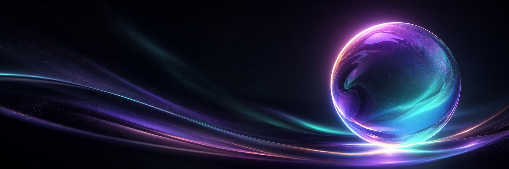
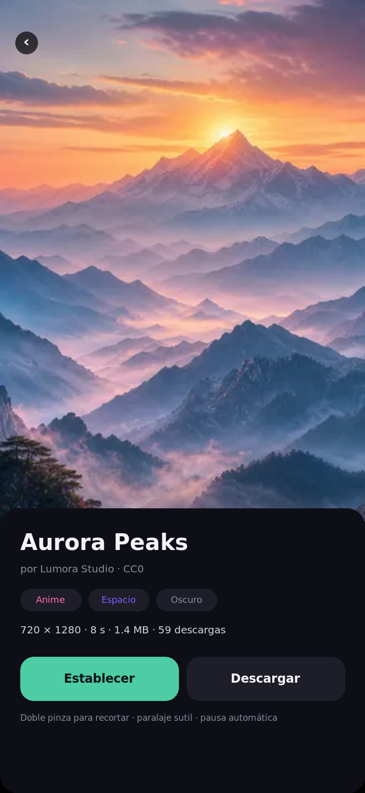

<p align="center">
  
</p>

<h1 align="center">Lumora</h1>

<p align="center">
  Wallpapers estáticos y <strong>animados</strong> para Android: importa tus fotos y videos cortos,
  mejóralos en el dispositivo y applícalos como fondo de pantalla. Con una tienda integrada de
  contenido libre de regalías.
</p>

<p align="center">
  <a href="https://github.com/karmaoriginal/fluffy-rotary-phone/actions/workflows/build.yml">
    
  </a>
  
  
  
  
  
  
  
</p>

---

## ✨ Por qué Lumora

- **Todo local y privado.** Nada de tus archivos sale del teléfono: la mejora de video se hace
  en el dispositivo con WorkManager.
- **Videos como fondo animado de verdad.** Un `WallpaperService` con ExoPlayer, bucle sin cortes,
  decodificación por hardware, sin audio (opcional) y pausado automáticamente cuando no se ve.
- **Tienda viva.** El catálogo es un `catalog.json` versionado en el repo y publicado con GitHub
  Pages; los archivos pesados pueden vivir en GitHub Releases.
- **Ligera.** R8 + `shrinkResources`, splits por ABI, iconos vectoriales, miniaturas WebP y nada de
  SDKs de terceros que no se usen.
- **Bonita.** Material 3 con color dinámico (Material You), modo AMOLED, malla tipo masonry,
  transiciones de elementos compartidos, parallax suave, shimmer y feedback al presionar.

## 📱 Funciones

### 1. Wallpapers propios
- Importación con **Photo Picker** y **SAF/Storage Access Framework** (cero permisos amplios de
  almacenamiento).
- Formatos de imagen: **JPG, PNG, WEBP, HEIC/HEIF, AVIF, GIF, BMP**.
- Formatos de video: **MP4, MKV, WEBM, MOV, 3GP**.
- Los archivos se copian a almacenamiento privado, se inspeccionan con `MediaMetadataRetriever` y
  se genera una miniatura WebP cacheada.

### 2. Aplicar fondos
- **Fotos:** `WallpaperManager` con inicio, bloqueo o ambos, y controles reales de **recorte,
  zoom y posición** con vista previa "probar antes de aplicar".
- **Videos:** `WallpaperService` con ExoPlayer → pantalla de inicio (fondo animado), silencio
  opcional y límite de 30/60 fps.

### 3. Mejora de calidad de video (una sola vez, en segundo plano)
- Al importar un video con resolución/bitrate bajos, Lumora ofrece **"Mejorar"**.
- Se ejecuta con **WorkManager** (progreso observable, cancelable, restricción de espacio libre).
- Pipeline incluido (Media3 Transformer, 100% en el dispositivo):
  reducción de ruido → **remuestreo Lanczos** a 1080p/1440p → claridad → recodificación **H.265**
  sin audio (fallback automático a H.264 si el SoC no tiene codificador HEVC).
- El original se sustituye al terminar (sin duplicar archivos) y la miniatura se regenera.
- **Upscaler con IA opcional** detrás de la interfaz `VideoEnhancer`, desactivado por defecto:
  ver [`docs/OPTIONAL_FFMPEG.md`](docs/OPTIONAL_FFMPEG.md).

### 4. Tienda integrada
- Catálogo por categorías (anime, paisajes, agua, colores, minimalista, espacio, naturaleza,
  abstracto, oscuro/AMOLED…), **buscador**, filtros, **favoritos**, **recientes** y **populares**.
- Miniaturas WebP pequeñas, **preview de video corto** y **descarga bajo demanda con reanudación**
  (`Range`), progreso por elemento, cancelación y ajuste "solo Wi-Fi".
- Fuente de datos resiliente: GitHub Pages → espejo `raw.githubusercontent` → caché en disco →
  catálogo empaquetado en el APK (la tienda nunca aparece vacía).

### 5. Biblioteca local
- Importados y descargados en un solo lugar, con favoritos, filtros y orden.
- Renombrar, eliminar, ver **espacio usado**, **limpiar caché** y límite de caché configurable.

### 6. Ajustes
- Tema (automático/claro/oscuro), color dinámico, **modo AMOLED**.
- Silenciar videos, límite de **30/60 fps**, descargas **solo Wi-Fi**.
- Mejora automática, resolución objetivo, upscaler IA (experimental), límite y limpieza de caché.

## 🖼️ Capturas

> Mockups de la interfaz generados a partir del contenido real del catálogo (720 × 1560).
> Para sustituirlos por capturas de un dispositivo, sobrescribe los archivos en `docs/assets/`
> conservando el mismo nombre (`screenshot-store.png`, `screenshot-library.png`,
> `screenshot-preview.png`, `screenshot-settings.png`).

| Tienda | Biblioteca | Vista previa | Ajustes |
|:---:|:---:|:---:|:---:|
|  |  |  |  |

## 🏗️ Arquitectura y stack

```
lumora/
├── app/                   # UI Compose, navegación, ViewModels, Workers, WallpaperService
├── core/
│   ├── model/             # modelos puros (LocalWallpaper, CatalogItem, AppSettings…)
│   ├── data/              # Room, DataStore, OkHttp, descargas, enhancer, apply
│   └── designsystem/      # tema Material 3, componentes, iconos propios
├── docs/                  # GitHub Pages: catalog.json, índice y contenido CC0
├── tools/                 # generador de catálogo (manifest -> catalog.json)
└── .github/workflows/     # CI: APK release firmado + artifacts + releases por tag
```

**Patrón:** MVVM (ViewModel + `StateFlow` + Compose), repositorios en `:core:data`, inyección de
dependencias manual y explícita (`AppContainer`, `LumoraWorkerFactory`), sin frameworks de DI.

| Capa | Tecnología |
|---|---|
| UI | Jetpack Compose, Material 3, Navigation Compose, animaciones compartidas |
| Imágenes | Coil + decoders GIF y video, miniaturas WebP generadas localmente |
| Video | Media3 **ExoPlayer** (reproducción) y **Transformer** (recodificación) |
| Datos | **Room** (biblioteca) + **DataStore** (ajustes y favoritos) |
| Red | **OkHttp** (catálogo, descargas reanudables) |
| Trabajo en background | **WorkManager** (mejora de video, restricciones, progreso) |
| Serialización | kotlinx.serialization |
| Build | Gradle KTS + version catalog, AGP 8.7, Kotlin 2.0, JDK 17 |

## ⬇️ Descargar el APK

1. **Releases** (recomendado): entra en
   [Releases](https://github.com/karmaoriginal/fluffy-rotary-phone/releases) y descarga el APK del
   último tag `v*`.
2. **GitHub Actions**: abre el run más reciente de
   [Build APK](https://github.com/karmaoriginal/fluffy-rotary-phone/actions/workflows/build.yml),
   baja hasta **Artifacts** y descarga `lumora-apks`.
3. **Compílalo tú**: ver la sección siguiente.

Hay un APK universal y variantes por ABI (`arm64-v8a`, `armeabi-v7a`, `x86_64`). Para la mayoría de
móviles modernos, `arm64-v8a` es el más pequeño. El APK de CI está firmado con un keystore efímero
(o con los secrets del repo si existen), así que es instalable directamente.

## 🔨 Compilar

Requisitos: **JDK 17** y Android SDK (`compileSdk 35`). El repositorio incluye el Gradle wrapper.

```bash
git clone https://github.com/karmaoriginal/fluffy-rotary-phone.git
cd fluffy-rotary-phone
./gradlew :app:assembleDebug      # APK de depuración
./gradlew :app:assembleRelease    # APK release (R8 + splits por ABI)
```

El artefacto aparece en `app/build/outputs/apk/release/`.

### Firma de release

Prioridad aplicada por `app/build.gradle.kts`:

1. `LUMORA_KEYSTORE` (+ `LUMORA_KEYSTORE_PASSWORD`, `LUMORA_KEY_ALIAS`, `LUMORA_KEY_PASSWORD`).
2. `keystore/lumora-release.jks` local (ignorado por git).
3. `~/.android/debug.keystore`, para que `assembleRelease` siempre produzca un APK instalable.

En CI, si no existen los secrets `KEYSTORE_BASE64`/`KEYSTORE_PASSWORD`/`KEY_ALIAS`/`KEY_PASSWORD`,
el workflow genera un keystore efímero.

## 🛍️ Añadir contenido a la tienda

El catálogo se genera a partir de un manifiesto, así que añadir contenido son tres pasos:

1. **Añade los archivos** en `docs/content/`:
   - `full/<archivo>.webp` — imagen completa (~1080 px de alto, calidad 82).
   - `thumbs/<archivo>.webp` — miniatura (~400 px, calidad 78).
   - `videos/<archivo>.mp4` — video de bucle corto (H.264, 720p, 6–10 s).
   - `previews/<archivo>-preview.mp4` — preview ligero (480p, ~4 s).
2. **Describe el elemento** en `tools/content-manifest.json`:

   ```json
   {
     "id": "art-mi-wallpaper",
     "file": "mi-wallpaper",
     "title": "Mi wallpaper",
     "kind": "image",
     "categories": ["paisajes"],
     "tags": ["montaña", "nieve"],
     "addedAt": "2026-12-01",
     "downloads": 0
   }
   ```

3. **Regenera el catálogo** y publica:

   ```bash
   python3 tools/build_catalog.py   # docs/catalog.json + assets del APK
   git add . && git commit -m "content: mi wallpaper" && git push
   ```

GitHub Pages sirve `docs/` (incluye `catalog.json`, el índice navegable y el contenido). La app
lee `catalog.json` desde `BuildConfig.CATALOG_URL`.

**Archivos pesados:** sube los MP4/imágenes grandes a un **GitHub Release** (por ejemplo el tag
`content-<n>`) y usa esas URLs absolutas en el manifiesto; `fullUrl` acepta cualquier URL HTTPS.
El contenido inicial de Lumora es pequeño (≈4 MB) y por eso viaja en `docs/`, pero la app soporta
igual Releases, S3, Bunny, Cloudflare R2 u otro hosting gratuito.

### Esquema de `catalog.json`

```jsonc
{
  "version": 2,
  "updatedAt": "2026-11-22",
  "categories": [{ "id": "paisajes", "name": "Paisajes", "accent": "#4ECCA3" }],
  "items": [{
    "id": "art-aurora-peaks",
    "title": "Cumbre Aurora",
    "author": "Lumora Studio",
    "kind": "image",              // "image" | "video"
    "categories": ["paisajes"],
    "tags": ["montaña", "amanecer"],
    "width": 941, "height": 1672,
    "durationMs": 0,              // > 0 para videos
    "sizeBytes": 155542,
    "thumbUrl": "https://…/thumbs/aurora-peaks.webp",
    "previewUrl": "https://…/previews/aurora-peaks-preview.mp4",
    "fullUrl": "https://…/full/aurora-peaks.webp",
    "license": "CC0-1.0",
    "licenseUrl": "https://creativecommons.org/publicdomain/zero/1.0/",
    "sourceUrl": "https://…",
    "addedAt": "2026-11-20",
    "downloads": 1284,
    "featured": true
  }]
}
```

> ⚖️ **Regla del proyecto:** solo contenido CC0, de dominio público o arte original propio. Nada de
> material con copyright ni marcas registradas. Ver [`docs/CONTENT_LICENSE.md`](docs/CONTENT_LICENSE.md).

## ⚙️ Optimizaciones

**Tamaño del APK**
- R8 + `shrinkResources` + reglas ProGuard afinadas para Room, kotlinx.serialization, Media3 y Coil.
- Splits por ABI (`arm64-v8a` principal) + APK universal opcional.
- Iconos vectoriales propios (sin `material-icons-extended`), icono adaptativo con `monochrome`.
- Sin AppCompat, sin Google Play Services, sin SDKs de terceros innecesarios.

**Batería**
- El fondo animado se pausa cuando la pantalla se apaga, cuando el launcher no está visible o
  cuando el sistema entra en ahorro de batería (`PowerManager` + broadcasts, sin polling).
- Límite de fotogramas 30/60 fps aplicado al `Surface` del wallpaper.
- Cero trabajo en background no solicitado: WorkManager con restricciones (`requiresStorageNotLow`)
  y un único trabajo con nombre para la mejora de video.

**Rendimiento**
- `Baseline Profile` incluido (`app/src/main/baseline-prof.txt`) + `profileinstaller`.
- Listas lazy con `key`/`contentType` estables, grid staggered, Coil con cachés de memoria (20 %) y
  disco (192 MB) acotadas.
- Imágenes decodificadas al tamaño de pantalla (`inSampleSize` + escala exacta), miniaturas WebP.
- ExoPlayer liberado siempre en `DisposableEffect`/`onDestroy` (sin fugas de memoria).

**Almacenamiento**
- Importación copiada una sola vez; el video mejorado **reemplaza** al original.
- Caché de descargas reanudables con límite configurable y limpieza automática al arrancar y al
  guardar ajustes.

## 🤖 CI/CD

`.github/workflows/build.yml`:

- Se ejecuta en `push` a `main`/`arena/**`, en tags `v*` y manualmente (`workflow_dispatch`).
- JDK 17 + cache de Gradle (`gradle/actions/setup-gradle`).
- Genera (o usa) el keystore, compila `:app:assembleRelease --stacktrace` guardando `build.log`.
- Sube como artifacts el **APK**, el **log** y el **mapping de R8**.
- En tags `v*`, publica un **GitHub Release** con los APK adjuntos.
- Si el build falla, publica un **digest del error** como comentario de commit para depurar rápido
  (útil cuando el log no es accesible desde el entorno de CI del agente).

```bash
git tag v1.0.0 && git push origin v1.0.0   # publica el release con los APKs
```

## 🗺️ Roadmap

- [ ] Reproductor de video en la vista previa con control de posición (scrubbing).
- [ ] Editor de recorte con gestos de pinza además del zoom/desplazamiento actual.
- [ ] Backend **FFmpeg (ffmpeg-kit)** opcional con `hqdn3d` + `unsharp` reales y upscaler IA.
- [ ] Providers de catálogo remotos múltiples + paginación infinita.
- [ ] Widgets / atajos para aplicar el último wallpaper.
- [ ] Tests de UI (Compose) y de integración para el pipeline de mejora.
- [ ] Internacionalización (en/es) con `strings.xml` en lugar de texto embebido.
- [ ] Baseline Profile generado con Macrobrenchmark en CI.
- [ ] Soporte de video en pantalla de bloqueo cuando el OEM lo permita.

## 🧾 Créditos y licencias del contenido

- **Contenido inicial:** arte original creado para Lumora (ilustraciones y videos generados y
  postprocesados para este proyecto), dedicado al **dominio público CC0 1.0**. Puedes usarlo,
  modificarlo y redistribuirlo sin atribución.
- **Fuentes recomendadas** para ampliar el catálogo: [Pexels](https://www.pexels.com/license/),
  [Pixabay](https://pixabay.com/service/license-summary/),
  [Unsplash](https://unsplash.com/license) y
  [Openverse](https://openverse.org/) (filtrando CC0).
- **Código de terceros:** Jetpack Compose, Media3, Coil, OkHttp, Room, WorkManager y
  kotlinx.serialization, todos bajo Apache 2.0 (ver `docs/CONTENT_LICENSE.md`).

## 📄 Licencia

Código bajo [MIT](LICENSE). Contenido de la tienda bajo CC0 1.0.

<p align="center"><sub>Hecho con cariño para pantallas que merecen algo mejor que un gradiente por defecto.</sub></p>
